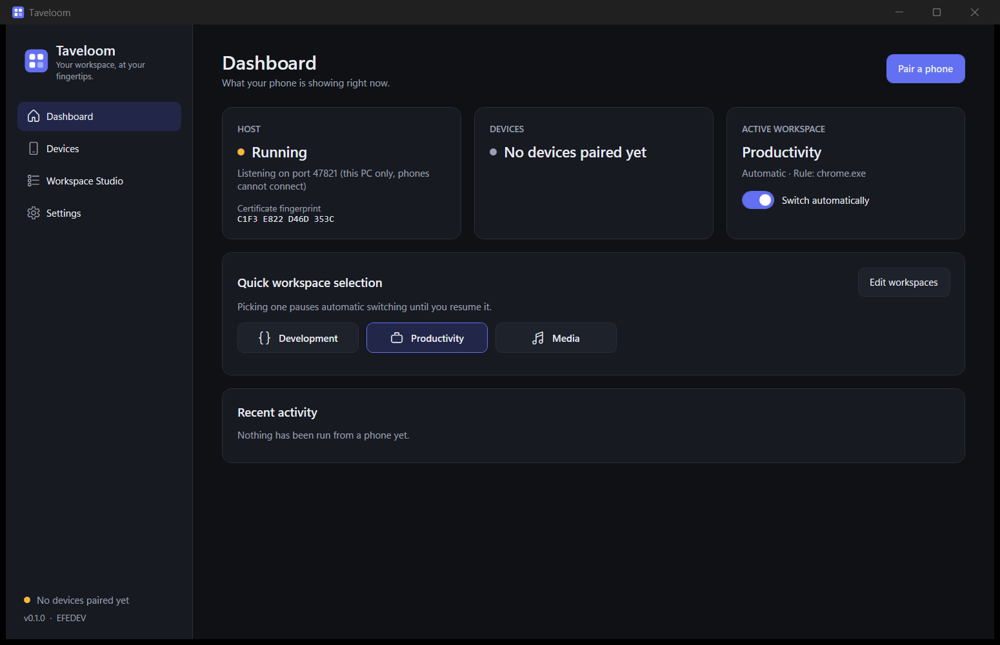
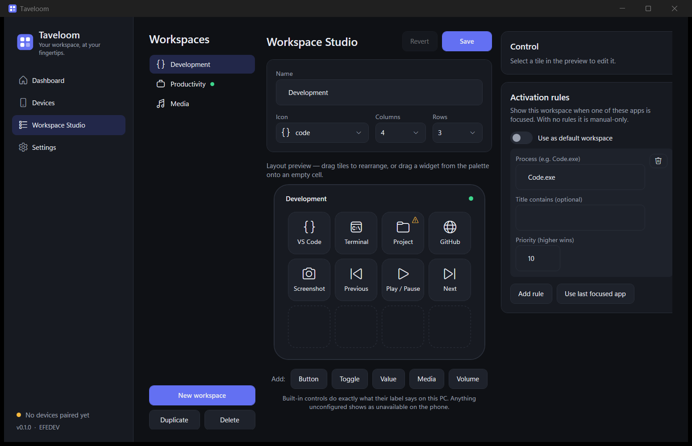

# Taveloom

<p>
  <a href="https://github.com/biliribrahimefe-crypto/taveloom/actions/workflows/ci.yml"></a>
  <a href="LICENSE"></a>
  
  
  
</p>

**Your workspace, at your fingertips.**

<sub>Distributed under the Tavrynt Studios brand ([NOTICE](NOTICE.md)).</sub>

Taveloom turns an Android phone or tablet into a real-time control surface for a Windows 11 PC. What sets it apart from a plain
button deck is the **Adaptive Workspace Engine**: Taveloom notices which app you are using and shows the controls that matter for it.

> **Project status: controlled beta (0.2.0-beta, release candidate in preparation), not production-ready.**
> The Windows host/app and the Android app work together; the core flows were tested on **one physical Android phone**
> (see [What was tested](#what-was-tested)). It has not had an independent security audit, builds are unsigned, and only Windows 11 is supported.
> See [Current limitations](#current-limitations).

<p align="center">
  
  
</p>

<sub>Real screenshots of the Windows app (captured in loopback-only development mode, hence "this PC only"). Android screenshots
have not been added yet.</sub>

## What works today

| Area | Status |
| --- | --- |
| Secure pairing: QR code, one-time token, pinned TLS certificate, explicit approval on Windows | Implemented; integration-tested over real TLS and confirmed on a physical phone |
| Authentication: challenge-response, revocation, rate limiting, audit log | Implemented, tested |
| Actions: hotkeys, launch app / folder / URL, media keys, volume and mute, screenshot, lock PC | Implemented; real Windows APIs probed on a dev machine |
| Live widgets: button, toggle, value display (CPU, RAM, volume, mic), media control, volume slider | Implemented; Play/Pause, volume slider and screenshot confirmed on a phone |
| Adaptive workspaces: focus-based rules, priorities, default fallback, manual override, debounce | Implemented, tested |
| Workspace Studio: create, rename, duplicate, delete, drag-and-drop layout, rules, "run on this PC" | Implemented |
| Starter workspaces: Development, Productivity, Media (editable) | Implemented |
| Windows app: dashboard, devices, settings, dark/light theme, tray, start with Windows | Implemented |
| Android app (Flutter): onboarding, QR scan, controls, reconnection, background/resume | Implemented; confirmed on one physical phone; CI builds the APK |
| Windows installer (per-user, Inno Setup) | Implemented; install/upgrade/uninstall tested locally; **unsigned** |
| Code-signed builds, Google Play release, LAN auto-discovery, media track info | Not built |

## Getting started

### Windows

Download `Taveloom-Setup-<version>-win-x64.exe` from the release page and run it (per-user, no administrator rights). It is
**unsigned**, so SmartScreen warns; verify the SHA-256 from the release notes first. Details, updating, uninstalling and
troubleshooting: [docs/installation/windows.md](docs/installation/windows.md). A portable zip is also provided.

On first start allow Windows Firewall for **private networks** only, then use Devices → **Pair a phone**.

### Android

Install the `Taveloom-<version>-android.apk` from the release page (Android 7.0+; details and troubleshooting in
[docs/installation/android.md](docs/installation/android.md)), tap through the intro, scan the PC's QR code, and click **Allow**
on the PC. The beta APK is signed with the Taveloom release key (its certificate fingerprint is in the release notes); it is distributed outside Google Play.

## What was tested

Automated (local and GitHub Actions): .NET build, format and 117 unit/integration tests (real TLS WebSocket host); Flutter format,
analyze and unit tests; Android APK build; a script that runs the real Android client code against the real Windows host.

Manually, on **one** physical Android phone against the Windows app: QR scanning, immediate and delayed (25 s, 40 s) pairing approval,
pairing rejection, Android-side pairing timeout, device revocation, Play/Pause, volume slider, screenshot action, Wi-Fi interruption
and automatic reconnection, Windows restart and automatic reconnection, Android background/resume. Other phones, Android versions,
routers and Windows setups have not been tested.

## How it works

```
Android (Flutter) <== WSS, pinned certificate ==> Windows host (.NET 10) <-> WPF app
```

The PC is the authority. It owns devices, workspaces, rules, and every action definition. The phone draws the active workspace and
sends **control ids**, never commands. Foreground changes arrive through `SetWinEventHook`, so there is no polling.
Details: [architecture](docs/architecture/overview.md), [protocol](docs/architecture/protocol.md).

## Security model

Local network only, no cloud, no accounts. TLS with a certificate pinned through the QR code; a one-time 2-minute pairing token **plus**
an explicit Allow on the PC; HMAC challenge-response after pairing; DPAPI / Android Keystore for credentials; instant revocation;
rate limiting. There is no remote shell and the phone cannot name a program, path or key.

**Taveloom has not been independently audited.** Read the [security model and residual risks](docs/security/security-model.md)
and report problems via [SECURITY.md](SECURITY.md).

## Current limitations

* **Limited device coverage:** one physical phone has been used; other devices, Android versions and networks may behave differently.
* Only **Windows 11** was used for development; Windows 10 is untested.
* Media keys are sent to whatever player Windows chooses; Windows does not say whether it reacted. Track info is not shown.
* Hotkeys cannot reach elevated (administrator) windows.
* Workspace rules match the focused process and window title *at the moment focus changes*; title changes within one window
  (for example switching browser tabs) do not re-trigger rules.
* Connection settings (port, LAN on/off) apply after restarting Taveloom.
* The phone must be given the PC's address from the QR code; there is no auto-discovery, and a PC whose IP changes needs a new QR.
* Windows installer and executables are **unsigned** (SmartScreen warning); the Android APK is release-signed with a key that has no external reputation. No auto-update.
* Android release builds do not use R8 shrinking ([why](docs/release/r8-shrinking.md)); the APK is a few MB larger.

## Build from source

Requires the .NET 10 SDK and Windows 11 for the app and tests.

```bash
dotnet build Taveloom.sln -c Release
dotnet test Taveloom.sln -c Release
dotnet publish apps/windows/Taveloom.App -c Release -r win-x64 --self-contained true -o artifacts/windows-x64
scripts/build-installer.ps1      # installer (needs Inno Setup 6)
```

Android: see [docs/development/building.md](docs/development/building.md).

## Repository layout

```
apps/windows/Taveloom.Host   server, security, actions, workspaces, adaptive engine, storage
apps/windows/Taveloom.App    WPF app
apps/android                 Flutter app
packages/protocol            wire contract (C#)
tests/windows                unit + integration tests
docs/                        architecture, security, installation, development
```

## Contributing

See [CONTRIBUTING.md](CONTRIBUTING.md) and the [Code of Conduct](CODE_OF_CONDUCT.md).

## Privacy, support and notices

- [PRIVACY.md](PRIVACY.md): what is stored where; no accounts, no telemetry, no external servers.
- [SUPPORT.md](SUPPORT.md): how to get help and what to include in a bug report.
- [THIRD_PARTY_NOTICES.md](THIRD_PARTY_NOTICES.md): dependency licenses.
- Release engineering: [docs/release](docs/release) (installer, Android signing, R8).

## License

[MIT](LICENSE) © 2026 EFEDEV (original copyright preserved; see [NOTICE.md](NOTICE.md) about the Tavrynt Studios brand). Dependency licenses are listed in [THIRD_PARTY_NOTICES.md](THIRD_PARTY_NOTICES.md).
