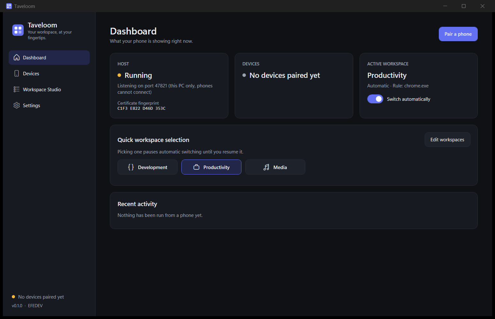
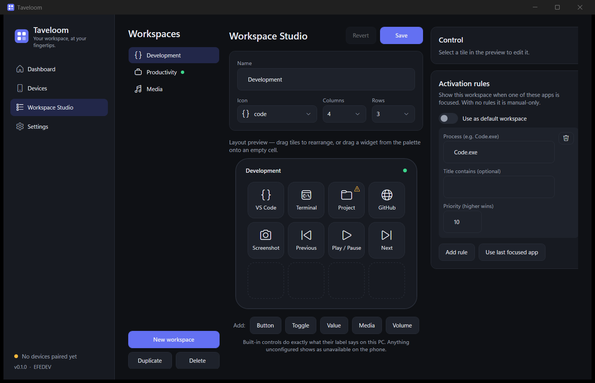

# Taveloom

<p>
  <a href="https://github.com/biliribrahimefe-crypto/taveloom/actions/workflows/ci.yml"></a>
  <a href="LICENSE"></a>
  
  
  
</p>

**Your workspace, at your fingertips.**

Taveloom turns an Android phone or tablet into a real-time control surface for a Windows 11 PC. What sets it apart from a plain
button deck is the **Adaptive Workspace Engine**: Taveloom notices which app you are using and shows the controls that matter for it.

> **Project status: pre-release (0.1.0), not production-ready.**
> The Windows host and app are implemented and tested. The Android app passes `flutter analyze` and its unit tests and builds
> into an APK, but it has **never been run on a phone or emulator**, so phone-to-PC operation is **not verified end to end**.
> See [Current limitations](#current-limitations).

<p align="center">
  
  
</p>

<sub>Real screenshots of the Windows app (captured in loopback-only development mode, hence "this PC only"). There are no Android
screenshots yet because the Android app has not been built.</sub>

## What works today

| Area | Status |
| --- | --- |
| Secure pairing: QR code, one-time token, pinned TLS certificate, explicit approval on Windows | Implemented, integration-tested over real TLS |
| Authentication: challenge-response, revocation, rate limiting, audit log | Implemented, tested |
| Actions: hotkeys, launch app / folder / URL, media keys, volume and mute, screenshot, lock PC | Implemented; real Windows APIs probed on a dev machine |
| Live widgets: button, toggle, value display (CPU, RAM, volume, mic), media control, volume slider | Implemented (host + Android source) |
| Adaptive workspaces: focus-based rules, priorities, default fallback, manual override, debounce | Implemented, tested |
| Workspace Studio: create, rename, duplicate, delete, drag-and-drop layout, rules, "run on this PC" | Implemented |
| Starter workspaces: Development, Productivity, Media (editable) | Implemented |
| Windows app: dashboard, devices, settings, dark/light theme, tray, start with Windows | Implemented |
| Android app (Flutter): onboarding, QR scan, controls, reconnection | Analyzes clean, 5 unit tests pass, APK builds; **never run on a device** |
| Installer (MSI/MSIX), signed builds, LAN auto-discovery, media track info | Not built |

## Getting started

### Windows

1. Download `Taveloom-0.1.0-win-x64.zip` (self-contained, no .NET install needed), unzip, run `Taveloom.exe`.
   The build is **unsigned**, so Windows SmartScreen will warn you.
2. The first time it listens on your network, Windows Firewall asks for permission. Allow **private networks** only.
3. Devices > **Pair a phone** shows a QR code.

### Android

A debug-signed `Taveloom-0.1.0-android-release.apk` can be built from source (see [apps/android/README.md](apps/android/README.md) and
[docs/development/building.md](docs/development/building.md)); it is not Play-Store signed. Then: install, tap through the intro, scan the QR code, and click
**Allow** on your PC.

## How it works

```
Android (Flutter) <== WSS, pinned certificate ==> Windows host (.NET 10) <-> WPF app
```

The PC is the authority. It owns devices, workspaces, rules, and every action definition. The phone draws the active workspace and
sends **control ids**, never commands. Foreground changes arrive through `SetWinEventHook`, so there is no polling.
Details: [architecture](docs/architecture/overview.md), [protocol](docs/architecture/protocol.md).

## Security model

Local network only, no cloud, no accounts. TLS with a certificate pinned through the QR code; a one-time 2-minute pairing token **plus**
an explicit Allow on the PC; HMAC challenge-response after pairing; DPAPI / Android Keystore for credentials; instant revocation;
rate limiting. There is no remote shell and the phone cannot name a program, path or key.

**Taveloom has not been independently audited.** Read the [security model and residual risks](docs/security/security-model.md)
and report problems via [SECURITY.md](SECURITY.md).

## Current limitations

* **Android is untested on hardware.** Analyze, unit tests and an APK build pass, but pairing, scanning, reconnection and actions have not been tried on a phone or emulator.
* Only **Windows 11** was used for development; Windows 10 is untested.
* Media keys are sent to whatever player Windows chooses; Windows does not say whether it reacted. Track info is not shown.
* Hotkeys cannot reach elevated (administrator) windows.
* Workspace rules match the focused process and window title *at the moment focus changes*; title changes within one window
  (for example switching browser tabs) do not re-trigger rules.
* Connection settings (port, LAN on/off) apply after restarting Taveloom.
* The phone must be given the PC's address from the QR code; there is no auto-discovery, and a PC whose IP changes needs a new QR.
* Unsigned build, no installer, no auto-update.

## Build from source

Requires the .NET 10 SDK and Windows 11 for the app and tests.

```bash
dotnet build Taveloom.sln -c Release
dotnet test Taveloom.sln -c Release
dotnet publish apps/windows/Taveloom.App -c Release -r win-x64 --self-contained true -o artifacts/windows-x64
```

Android: see [docs/development/building.md](docs/development/building.md).

## Repository layout

```
apps/windows/Taveloom.Host   server, security, actions, workspaces, adaptive engine, storage
apps/windows/Taveloom.App    WPF app
apps/android                 Flutter app
packages/protocol            wire contract (C#)
tests/windows                unit + integration tests
docs/                        architecture, security, installation, development
```

## Contributing

See [CONTRIBUTING.md](CONTRIBUTING.md) and the [Code of Conduct](CODE_OF_CONDUCT.md).

## License

[MIT](LICENSE) © 2026 EFEDEV. .NET dependencies: CommunityToolkit.Mvvm, Microsoft.Data.Sqlite, QRCoder, System.Drawing.Common (MIT) and
SQLitePCLRaw (Apache-2.0, bundling the public-domain SQLite). Flutter dependencies (`crypto`, `flutter_secure_storage`,
`mobile_scanner`): licenses still to be confirmed with a dependency license check before a public release.
